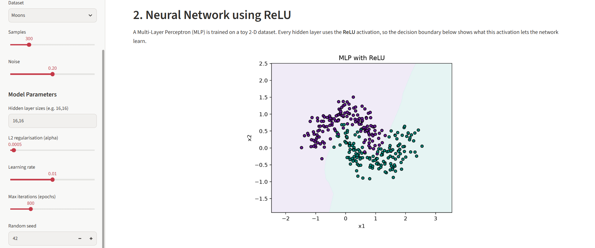
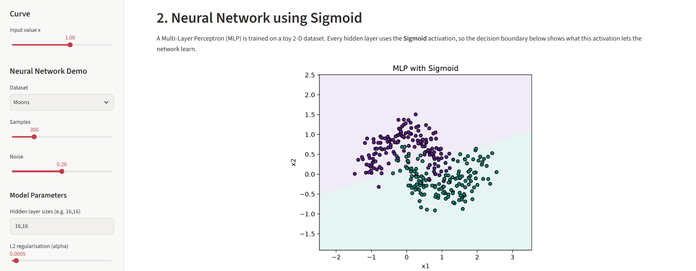
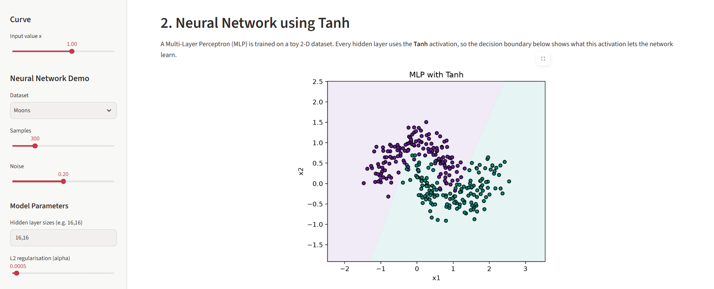

# Activation Function Visualisers (ReLU, Sigmoid, Tanh)

**Course: BSD3513 Introduction to Artificial Intelligence**

**Topic: Chapter 4: Neural Networks (Lab Report 4 - Question 2)**

Three separate Streamlit web applications that visualise common neural network activation functions and show how each one shapes the decision boundary of a small neural network.

---

## Live Demos

| Activation | Deployed URL |
|------------|--------------|
| ReLU |https://ai-labreport4-relu.streamlit.app/ |
| Sigmoid |https://ai-labreport4-sigmoid.streamlit.app/ |
| Tanh | https://ai-labreport4-tanh.streamlit.app/|

---

## Features

Each app has the same structure:

1. **Formula and derivative** shown in LaTeX.
2. **Output for your input:** pick a value of x in the sidebar and see x, f(x) and f'(x), together with a short list of the function's properties.
3. **Activation curve:** a plot of f(x) and its derivative f'(x) with your input marked on the curve.
4. **Neural network using the activation:** a Multi-Layer Perceptron (MLP) is trained on a toy 2-D dataset (Moons or Circles) with the chosen activation in every hidden layer, and its decision boundary is plotted.

### Sidebar controls

| Control | Description |
|---------|-------------|
| Input value x | Point to evaluate on the activation curve (-6 to 6) |
| Dataset | Moons or Circles |
| Samples / Noise | Size and noise level of the generated dataset |
| Hidden layer sizes | e.g. `16,16` for two hidden layers of 16 neurons |
| L2 regularisation (alpha) | Weight penalty used by the MLP |
| Learning rate | Step size for training |
| Max iterations (epochs) | Maximum training epochs |
| Random seed | Makes results reproducible |

---

## Activation Functions

| Function | Formula | Range | Derivative |
|----------|---------|-------|------------|
| ReLU | f(x) = max(0, x) | [0, ∞) | 1 if x > 0, else 0 |
| Sigmoid | f(x) = 1 / (1 + e^-x) | (0, 1) | f(x)(1 − f(x)) |
| Tanh | f(x) = (e^x − e^-x) / (e^x + e^-x) | (−1, 1) | 1 − tanh²(x) |

---

## Project Structure

```
.
├── relu.py          # ReLU visualiser + neural network demo
├── sigmoid.py       # Sigmoid visualiser + neural network demo
├── tanh.py          # Tanh visualiser + neural network demo
├── requirements.txt     # Python dependencies
├── screenshots/         # App screenshots used in this README
└── README.md
```

Inside each app file:

- `activation(x)` and `activation_derivative(x)` define the function and its gradient.
- `train_network(...)` generates the dataset and trains the MLP (cached with `st.cache_resource` so moving the x slider does not retrain the model).
- The remaining code builds the Streamlit layout and the Matplotlib plots.

---

## Installation and Usage

**Requirements:** Python 3.9 or newer.

```bash
# 1. Clone the repository
git clone 
cd YOUR-REPO

# 2. (Optional) create a virtual environment
python -m venv venv
venv\Scripts\activate        # Windows
source venv/bin/activate     # macOS / Linux

# 3. Install dependencies
pip install -r requirements.txt

# 4. Run any of the apps
streamlit run relu.py
streamlit run sigmoid.py
streamlit run tanh.py
```

The app opens in your browser at `http://localhost:8501`.

---

## Deployment (Streamlit Community Cloud)

1. Push this repository to GitHub.
2. Sign in at [share.streamlit.io](https://share.streamlit.io) with your GitHub account.
3. Click **Create app**, choose this repository and branch, and set the main file to `relu.py`.
4. Click **Deploy**.
5. Repeat for `sigmoid.py` and `tanh.py` to get three public URLs.

---

## Screenshots

| ReLU | Sigmoid | Tanh |
|------|---------|------|
|  |  |  |

---

## Technologies

- [Streamlit](https://streamlit.io) for the web interface
- [NumPy](https://numpy.org) for the activation maths
- [Matplotlib](https://matplotlib.org) for plotting
- [scikit-learn](https://scikit-learn.org) for datasets and the `MLPClassifier`

